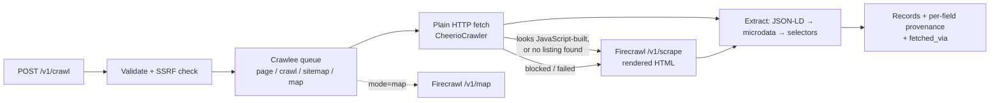

# crawlee-server

[](https://github.com/j-zulick/crawlee-server/actions/workflows/ci.yml)
[](https://github.com/j-zulick/crawlee-server/actions/workflows/codeql.yml)
[](test/README.md#coverage)
[](LICENSE)

**TL;DR:** a self-hosted crawling API. Give it a site and get back structured records instead of raw HTML.
[Crawlee](https://crawlee.dev) handles the fast, bounded crawl; [Firecrawl](https://github.com/firecrawl/firecrawl)
renders the pages that need JavaScript or block plain requests. Every record says where each field came from and how
the page was fetched. One container, one token, safe against requests to private addresses.

- **What:** `POST /v1/crawl` → records (title, text, schema.org product data, your own CSS fields, or vehicle listings).
- **Why:** browser-only scrapers are slow and costly; plain HTTP misses JavaScript-built pages. This uses plain HTTP
  first and Firecrawl only where it is needed, and tells you which pages needed it.
- **Who:** anyone collecting a catalogue, listing set or docs section from a known site: research and SEO tooling,
  data pipelines, AI agents that need clean records rather than page dumps.

## Try it in 2 minutes

```bash
docker run -d --name crawlee-server -p 127.0.0.1:8794:8794 \
  -e CRAWL_TOKEN="$(openssl rand -hex 32 | tee crawl.token)" \
  ghcr.io/j-zulick/crawlee-server:2.2.0

curl -s localhost:8794/v1/crawl -H "Authorization: Bearer $(cat crawl.token)" -H 'Content-Type: application/json' -d '{
  "start_urls": ["https://books.toscrape.com/catalogue/category/books/poetry_23/index.html"],
  "include_patterns": ["https://books.toscrape.com/catalogue/*_*/index.html"],
  "exclude_patterns": ["**/category/**"],
  "selectors": { "price": ".price_color", "availability": ".availability" },
  "max_pages": 8
}' | jq '.stats, .records[0]'
```

Add Firecrawl for JavaScript-heavy sites (see [docs/FIRECRAWL.md](docs/FIRECRAWL.md)):

```bash
docker run ... -e FIRECRAWL_URL=https://your-firecrawl.example -e FIRECRAWL_API_KEY_FILE=/run/secrets/firecrawl.key ...
# then, for example:
#   { "start_urls": ["https://www.groupon.com/travel/luxury"], "render": "auto", "max_pages": 5 }
```

Keep `max_pages` small when you point it at someone else's site.

## How it works



Crawlee owns the queue, limits, robots.txt, SSRF checks and extraction. Firecrawl only fetches. More in
[docs/ARCHITECTURE.md](docs/ARCHITECTURE.md).

## Request

| Field | Default | Meaning |
|---|---|---|
| `start_urls` | required | 1–10 pages to start from; the crawl stays on these hostnames |
| `mode` | `crawl` | `page` (start URLs only), `crawl` (follow links, depth ≤ 3), `sitemap` (`/sitemap.xml`), `map` (Firecrawl site map) |
| `render` | `auto` | `auto` (Firecrawl only when needed), `never`, `always`; needs `FIRECRAWL_URL` |
| `profile` | `generic` | `generic` or `vehicle` |
| `include_patterns` / `exclude_patterns` | — | globs; `*` = one path segment, `**` = anything |
| `selectors` | — | named CSS selectors to return as fields (generic) or to override fields (vehicle) |
| `max_pages`, `max_depth`, `concurrency` | 50, 2, 3 | capped by the server limits below |
| `capture` | `false` | `true` stores the raw page for each record and adds `capture_id`, `sha256` and `fetched_at` to it (see [docs/CAPTURE.md](docs/CAPTURE.md)) |

The response has `status`, `stats`, `records`, `failures`, `refused` (with reasons), a `firecrawl` block (pages
rendered, blocked pages recovered, failures) and `limitations`.

## Reading captures

`GET /v1/captures/:id` returns the stored raw page with its original `Content-Type` and the headers
`X-Capture-SHA256`, `X-Capture-Fetched-At`, `X-Capture-URL` and `X-Capture-Crawl-Id`. It also sets
`Content-Security-Policy: sandbox`, `X-Content-Type-Options: nosniff` and `Content-Disposition: attachment`.
`GET /v1/captures/:id/meta` returns the metadata as JSON only (the cheaper call for a hash check). Both need the
bearer token and only work for the client whose token made the crawl.

| Status | Meaning |
|---|---|
| 401 | missing or wrong token |
| 400 `invalid_capture_id` | the id is not 48 lowercase hex characters |
| 404 `capture_not_found` | unknown, expired or owned by another client (one identical answer) |
| 429 `rate_limited` | more than `CRAWL_CAPTURE_READS_PER_MIN` reads (default 60) per client per minute |
| 500 `capture_corrupt` | the stored bytes no longer match their SHA-256; no body is returned |

Reads do not use the one-crawl-at-a-time slot. Details: [docs/CAPTURE.md](docs/CAPTURE.md).

## Status

| Feature | State |
|---|---|
| Bounded crawl (page / crawl / sitemap), limits, one crawl at a time with a small queue | **Demonstrated:** tests in `test/service.test.mjs` |
| Generic records: title, description, text, schema.org product, named CSS fields | **Demonstrated** |
| Vehicle listings: JSON-LD → microdata → selectors, per-field `extractor`, VIN check digit | **Demonstrated:** offline fixture site, ≥ 98% field accuracy asserted |
| Firecrawl rendering (`render=auto/always`), blocked-page recovery, `mode=map`, render budget | **Demonstrated** against a fake Firecrawl API in `test/firecrawl.test.mjs` |
| SSRF guard: private, loopback, link-local, metadata and CGNAT addresses refused, including after redirects and for Firecrawl's final URL | **Demonstrated** |
| Firecrawl against a live self-hosted instance | **Locally verified:** see [CHANGELOG](CHANGELOG.md) |
| Playwright browser mode as an alternative to Firecrawl | **Proposed** (v2.1) |
| Durable jobs that survive restarts | **Proposed** (v2.3) |
| Hash-checked page captures (`capture: true`): raw body, SHA-256, fetch time | **Demonstrated:** tests in `test/capture.test.mjs`; container start with a read-only root and a volume not yet run in CI |

## Server settings

| Variable | Default | |
|---|---|---|
| `CRAWL_TOKEN_FILE` or `CRAWL_TOKEN` | required | bearer token, 24+ characters |
| `CRAWL_MAX_PAGES` / `CRAWL_MAX_CONCURRENCY` / `CRAWL_MAX_SECONDS` | 300 / 5 / 150 | hard caps per crawl |
| `CRAWL_IGNORE_ROBOTS` | `false` | `true` turns robots.txt checks off; `/healthz` and every result say so |
| `CRAWL_PROXY_URL`, `CRAWL_USER_AGENT` | — | outbound proxy, user agent |
| `FIRECRAWL_URL`, `FIRECRAWL_API_KEY_FILE` | off | enable Firecrawl; the key is never logged or returned |
| `FIRECRAWL_MAX_RENDERS`, `FIRECRAWL_CONCURRENCY`, `FIRECRAWL_TIMEOUT_MS` | 25, 2, 45000 | Firecrawl budget per crawl |
| `CRAWL_CAPTURE_DIR` | — | writable directory for page captures; without it `capture: true` returns `partial` |
| `CRAWL_CAPTURE_DEFAULT` | `false` | `true` captures when a request omits `capture` |
| `CRAWL_CAPTURE_READS_PER_MIN` | 60 | capture reads per client per minute |
| `CRAWL_CAPTURE_MAX_BYTES` / `CRAWL_CAPTURE_MAX_TOTAL_BYTES` / `CRAWL_CAPTURE_TTL_DAYS` | 5000000 / 1073741824 / 30 | per-page cap, total cap, retention |

## Security

- Bind it to localhost or a private network; `/healthz` is the only route without the token.
- Container: read-only filesystem, no Linux capabilities, memory/CPU/process limits (see `compose.yaml`).
- Report issues privately: [SECURITY.md](SECURITY.md).

## Integrations

- **HTTP:** anything that can POST JSON.
- **Evidence Search** (a self-hosted research engine, not yet public): its gateway exposes this service to AI clients
  as the MCP tools `crawl_site` and `crawl_inventory`.

## Develop

```bash
npm ci && npm test          # offline: fixture site + fake Firecrawl, no internet needed (Node 22, 24 or 26)
npm run coverage            # same tests plus a coverage report; fails under the thresholds (see test/README.md)
docker build -t crawlee-server .   # the build runs the tests too
```

## History, credits and AI assistance

First built and deployed in 2025 as a small Express prototype; rebuilt in Nov 2026 as this service (see
[CHANGELOG.md](CHANGELOG.md)). Built on Crawlee (Apache-2.0), Cheerio (MIT) and zod (MIT): [NOTICES.md](NOTICES.md).
Who did what, including AI assistance: [docs/CONTRIBUTIONS.md](docs/CONTRIBUTIONS.md).
