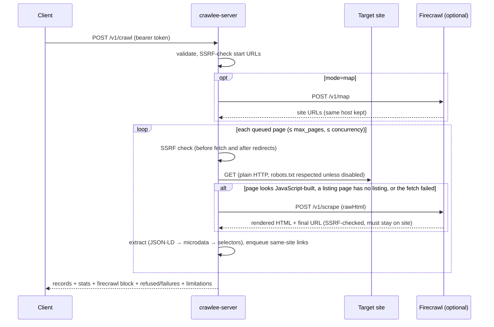

# Architecture

One crawl request = one fresh, in-memory Crawlee run. No shared queue, no disk state, nothing kept after the reply.

## Design choices

**HTTP first, Firecrawl when needed.** Most catalogue and listing pages are server-rendered; fetching them with a
browser costs seconds and hundreds of MB each. `render=auto` sends a page to Firecrawl only when its HTML has almost
no visible text but runs scripts, shows a "please enable JavaScript" notice, has an empty app root, or (for listing
pages) yields no listing. JSON-LD blocks are data, not code, so they never trigger a render. A per-crawl budget caps the
cost. Every record carries `fetched_via` so a caller can see what the rendering cost bought.

**Crawlee owns the crawl; Firecrawl only fetches.** Queue, depth, limits, robots.txt, SSRF checks and extraction stay
in one place whichever way a page was fetched, so results look the same either way.

**Provenance per field.** The vehicle profile records which method found each field (`jsonld`, `microdata`,
`selector`) and which required fields are missing. Missing fields are the signal that a site changed its markup
("extractor drift") or needs a model-based fallback.

**Captures are opt-in and separate from jobs.** With `capture: true` the raw page, its SHA-256 and fetch time are
written to a volume during the crawl ([CAPTURE.md](CAPTURE.md)). They do not depend on crawl or job state, and a
capture problem degrades the response to `partial` instead of failing the crawl.

**Fail closed on addresses, fail soft on fetches.** A private, loopback, link-local, metadata or CGNAT address is
refused at every hop, including the URL Firecrawl reports after rendering. A failed fetch or Firecrawl outage becomes
a listed failure; the crawl still returns what it has.

**Bounded by default.** 300 pages, 5 concurrent, 150 s and one crawl at a time per instance (2 queued, then 429).
Run more instances for more throughput.
